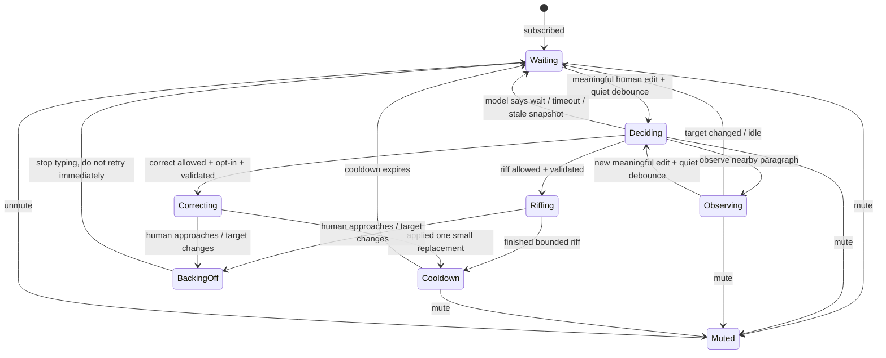

# Model-driven agent presence and engagement

## Goal

Use a fast OpenAI decision-capable model as a *social policy* for the
existing Automerge agent runner: where should its ephemeral cursor be,
should it stay quiet, and when is a brief nearby contribution welcome?
It may also make *permitted*, tiny corrections to freshly typed text, usually
behind the human cursor. The runner remains responsible for synchronization,
placement, safety, and actual edits. This is not a model call per keystroke.

“Latest decision model” should be a configurable model ID rather than
a hardcoded product name: availability, latency, pricing, and
capabilities change. Start with a small/fast model that supports
structured outputs; benchmark the model available to the deployment
before choosing it. Keep the API key only in the separate Node
process, never in the browser or Automerge document.

## Approaches

| Approach                                   | How it works                                                                                                                                                                       | Tradeoff                                                                               |
|--------------------------------------------|------------------------------------------------------------------------------------------------------------------------------------------------------------------------------------|----------------------------------------------------------------------------------------|
| Model controls every cursor movement       | Call the model whenever a human cursor or text changes.                                                                                                                            | Responsive in theory, but slow, expensive, noisy, and prone to stale decisions. Avoid. |
| Periodic model poll                        | Every N seconds, send a snapshot and ask what to do.                                                                                                                               | Simple, but wastes calls while idle and can miss the right moment.                     |
| Event-driven decisions                     | Coalesce meaningful text/selection/history changes and call after a quiet period.                                                                                                  | Better cost and timing; needs debounce and staleness handling.                         |
| **Hybrid policy + deterministic executor** | On meaningful events, ask the model for a coarse decision (`wait`, `observe`, `riff`, or, when enabled, `correct`) and target. Cheap code moves the cursor, applies rate limits, and validates edits. | Best first experiment: model decides intent, code guarantees safe behavior.            |
| Streaming/realtime conversation            | Keep an ongoing model session with document events.                                                                                                                                | Potentially more natural but harder to control, budget, replay, and test. Defer.       |

## Separation of responsibilities

- **Browser:** sends human cursors ephemerally; renders agent cursor/status; keeps mute control and text edits as today.
- **Agent runner:** receives Automerge heads/cursors, maintains a local state machine and quiet timers, calls the model only on meaningful triggers, validates decisions, broadcasts ephemeral cursor/status, and performs bounded inserts or explicitly permitted small replacements.
- **Model:** receives a *small* recent context, returns a constrained intent and reason; it does not receive raw Automerge write access or invent cursor strings/offsets.
- **Automerge:** ephemeral messages for cursor/status; normal versioned changes for text. Moving a cursor never changes the document.

The model should choose a semantic target, such as `paragraph_above`, `paragraph_below`, or `stay`, plus `wait`/`observe`/`riff`. For an enabled correction, it should propose an exact short `before`/`after` replacement within a recent edit range, not arbitrary document offsets. The runner computes the actual Automerge cursor from the current document and keeps it out of the human's position. Do not send a full document or call the model for each cursor heartbeat; rebroadcast the last valid cursor locally at the presence interval.

## Decision loop

1. Subscribe to the document and recent human cursors. Maintain a small window of document heads, recent human-authored text changes and their ranges, active human paragraph(s), last agent action, cooldowns, and mute/permission state. Ignore cursor heartbeats and the agent's own changes as model triggers.
2. Debounce meaningful human text changes (for example 3–5 seconds of quiet). Optionally trigger on a checkpoint/merge, but do not generate prose by default for control-only changes.
3. Supply the model with at most a few nearby paragraphs, recent change summary, current human cursor paragraph (not identity unless needed), previous decision, and time since last contribution. Ask for structured output, for example:

   ```json
   {"action":"wait|observe|riff", "target":"above|below|stay", "reason":"short explanation"}
   ```

   Only call a generator after an approved `riff` decision. Once corrections are enabled, `correct` can request a separate, strictly bounded proposal `{before, after, reason}` based on the *recent human edit*, not the full document. This keeps common `wait`/`observe` calls cheap.
4. Validate against current heads, paragraph anchors, schema, length, rate limits, mute state, and other users' active cursors. On stale context or timeout, **wait**, not write. A move to a non-overlapping nearby paragraph can be recalculated locally.
5. Broadcast a new ephemeral cursor/status only if the intent or target changed; never jiggle the cursor just to signal activity. If a riff is allowed, generate at most a few bullets, preview/check the insertion point again, then type via the existing incremental agent edit path. For a permitted correction, put the agent cursor at the exact target *behind* the human, recheck the original text and heads, and apply one small Automerge replacement with agent attribution. Do not simulate character-by-character replacement of existing text. Stop immediately if a human cursor approaches the target.
6. Log structured reasons for decisions and overrides locally (heads/paragraph ids, latency, action, skipped reason), without logging entire documents or secrets.

## Proposed state machine

The runner owns these states; the model only suggests a transition at `Deciding`. Cursor/status broadcasts are effects of states, not model-generated Automerge cursors. An ephemeral `mute` overrides any state (including typing); an `unmute` returns to waiting, not straight to writing.



- **Waiting:** no write; cursor stays stable or hidden. Debounce and per-paragraph/global cooldown checks happen before a model call.
- **Deciding:** one in-flight structured decision against captured heads and a recent human edit. `wait` is the default on error, uncertainty, or stale context.
- **Observing:** move an ephemeral cursor to a safe nearby paragraph, not onto a human cursor. Cursor heartbeats do not cause model calls.
- **Riffing:** type short text *adjacent* to the human paragraph. Keep checking for interruption while typing.
- **Correcting:** only with explicit permission and an exact recent `before` match behind the human cursor; make one attributable replacement and expose Undo. The proposed `correct` transition is not available in experiments 1–3.
- **BackingOff:** abort on human presence in the range, mute, or invalidated context; avoid immediately trying again at the same site. A partial riff remains an ordinary editable change, while a correction is applied atomically or not at all.
- **Cooldown:** inhibit repeat contributions even if more changes arrive. Mute is available throughout; while muted the agent sends no cursor or edits.

## Safeguards for natural behavior

- **Quiet by default:** `wait` is a useful decision. Require an explicit reason for `riff`; cap frequency and length, per paragraph and globally.
- **Avoid crowding:** never put the agent cursor on the human cursor. Prefer a nearby *different* paragraph; if none exists, leave cursor where it is or hide it rather than chase the human around a single paragraph.
- **Respect multiple humans:** track cursors separately; avoid any active paragraph or insertion site another person is editing. Don't let the most recent heartbeat hijack the agent's focus. A correction behind one user's cursor is allowed only if no human is selecting or editing that target range.
- **No slop:** model output is a suggestion, not a command. Validate short length, adjacency, repeated-content detection, and cooldowns. Back off after users delete/rework a riff or undo a correction.
- **Tiny corrections need permission:** make direct correction opt-in (separate from mute). Initially permit only unmistakable typos, punctuation, simple grammar, or a minor clarity edit within text typed in the last few seconds. No change of meaning, paragraph reorganization, or edits to older text. Prefer `wait` if uncertain.
- **Behind the cursor:** require the proposed range to be within the recent human edit and wholly before the user's current cursor, with a small distance buffer; do not edit selected text, the word being typed, or the cursor position itself. If the user moves back into the range, cancel. If no suitable range exists, wait or choose an adjacent riff instead.
- **Safe replacement and reversibility:** keep the original short text, anchored range/heads, replacement, agent identity, and reason with the change (or a small linked record). Recheck that the current range *still exactly matches* `before` just before writing; abort on mismatch or concurrent human edits. Surface the correction briefly in the UI with an Undo action; undo is a compensating Automerge edit, not a history rewrite. Initially disable further corrections to the same range after undo.
- **Live text is untrusted input:** document text can contain instructions addressed to the model. Treat it as data; keep policy in the runner/system instructions and enforce it in code.
- **Staleness and failures:** decisions carry the heads/paragraph anchor they were based on; discard on relevant change. Timeout/API failure falls back to deterministic `wait`/safe cursor behavior. Mute should override all model decisions.
- **Ephemeral controls have scope:** current mute is an ephemeral command to one runner; it may not survive a restart or coordinate multiple runners. Do not promise persistent/team-wide mute without adding durable shared policy.

## Small MVP experiments

**Experiment 1 — Decisions without edits.** Replace the runner's canned `watching/thinking` choice with an event-driven structured model decision limited to `wait` or `observe` and `above|below|stay`. Compute/move the ephemeral cursor in code. Throttle calls (e.g. at most one per 15–30 seconds after quiet), leave the cursor stable between calls, and display a *short* reason in the Assistant tab. Compare against deterministic placement: does the cursor feel present, not distracting? Log latency, calls, and skipped decisions.

**Experiment 2 — Bounded engagement.** Add `riff` as a possible decision **only after** the cursor behavior works. Keep the existing canned `generateRiff` initially. Gate it by quiet time, non-overlap, staleness checks, and cooldowns; observe whether model-selected timing improves on the existing deterministic trigger. No new persistence schema.

**Experiment 3 — Model-generated riff.** Replace only `generateRiff` with an LLM call for 1–3 short bullets, preserving the exact same validation, insertion, incremental typing, and human interruption path. Compare usefulness versus canned riffs and track deletions/edits as feedback before adding any further autonomy.

**Experiment 4 — Opt-in corrections of recent text.** Separately enable a `Correct recent text` control. Start with a deterministic, obvious typo (e.g. `teh` → `the`) *only* in a recently typed range behind the human cursor. Highlight the change and offer Undo. Test multi-user interference, moving the cursor into the range, text changing while the model thinks, and undo. Once that is safe, allow the model to propose the same constrained `{before, after, reason}` operation for tiny spelling, grammar, and minor clarity changes. Track acceptance/undo rates. The model may choose `wait` rather than correct; the validator retains final authority.

Start with a single runner, one document URL, one model call at a time, and only the existing Assistant tab/mute control for experiments 1–3. The correction permission and Undo control are added **only in experiment 4**. Avoid tasks, branch automation, full rewrites, continuous model sessions, and per-keystroke calls for this proof.
